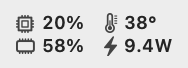
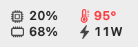
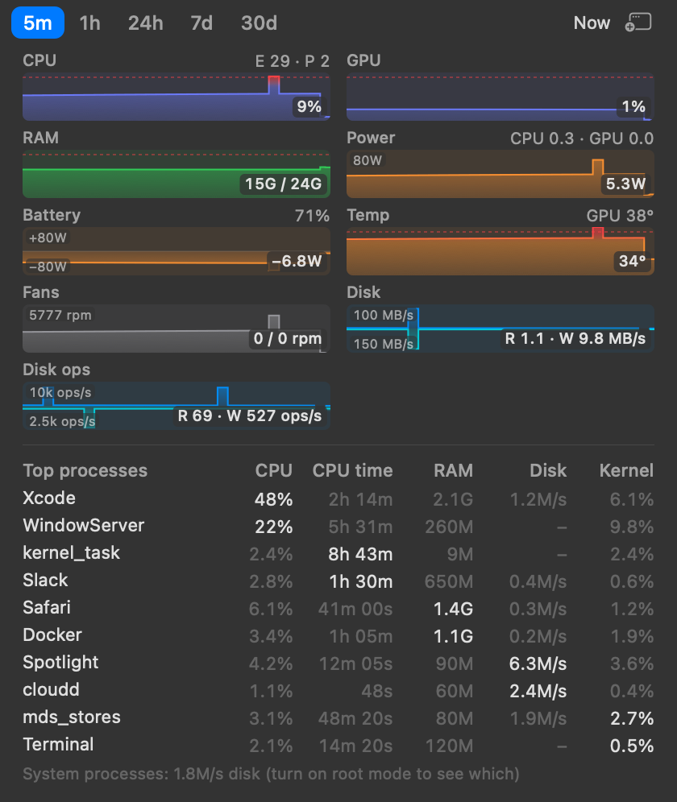

#  MacMon Indicator

A tiny macOS menu bar monitor for Apple Silicon: CPU, GPU, RAM, power, battery, temperature,
fans and disk, with up to 30 days of history and a top-processes list. Sensor data comes from
[macmon](https://github.com/vladkens/macmon) (sudoless). This project is an unofficial frontend for it.

| Menu bar | Warning | Menu |
|---|---|---|
|  |  |  |

_Screenshots use demo history and demo process names._

## Features

- **Two-line menu bar item** with an icon per value (or one line, icons optional). Pick up to 6 metrics,
  and adjust text size, line spacing, item spacing and opacity. Values turn orange or red past your limits.
- **Menu**: a native macOS menu, so it has the same glass look as your other menu bar menus. It holds
  filled bar charts for 5m (default) / 1h / 24h / 7d / 30d in one or two columns. You choose which
  charts appear and in what order, and where the values go (in the chart, on the label row, or split).
  The solid bar is the average, the faint bar is the peak, so short spikes stay visible. CPU, GPU,
  RAM and Temp bars blend into red as they near your warning limits, and values past a limit show
  in red. Hover to read values at any moment. **Click a chart** to see it alone at full width with its
  scale; click again to go back. Chart height is adjustable.
- **Top processes**: CPU, CPU time, RAM, disk and kernel time. By default you get the top 2 by each
  column (10 rows); click a column to see the top 10 by that column (click again to go back).
- **Dashboard window**: click the window button next to "Now" in the menu (or **Open in Window**)
  to keep the charts and processes on screen. Resize it and the charts grow and the process list
  shows up to 20 rows. It reopens where you left it, also after login. While it's open the app
  shows in the Dock and ⌘-Tab; close it and the app goes back to the menu bar only.
- **Battery** charge/discharge watts, **disk** read/write throughput and **disk operations** per
  second. Many small reads or writes (a big `git status`, an indexer, a package install) can slow
  the whole Mac while the MB/s stay low; the **Disk ops** chart shows them.
- **Optional root mode** to see disk use of system processes (Spotlight, Time Machine, …).
- Starts at login, no Dock icon (unless the dashboard window is open), stays out of the way.

## Requirements

Apple Silicon Mac, macOS 13 or newer. That's all for the download: macmon is included in the app.

## Install

### Homebrew

```bash
brew install --cask vothanhdat/tap/macmon-indicator
```

Then open **MacMon Indicator** and turn on **Settings… → Launch at login**. Update with
`brew upgrade --cask macmon-indicator`; remove with `brew uninstall --cask macmon-indicator` (add
`--zap` to also delete history and settings). The cask clears the quarantine flag for you, so there
is no Gatekeeper prompt.

### Download

1. Download `MacMon-Indicator-<version>.zip` from
   [Releases](https://github.com/vothanhdat/macmon-menubar/releases/latest), unzip it, and move
   **MacMon Indicator.app** to `/Applications`.
2. The app isn't notarized (that needs a paid Apple Developer ID), so macOS blocks a downloaded copy
   the first time. Either run this once:
   ```bash
   xattr -dr com.apple.quarantine "/Applications/MacMon Indicator.app"
   ```
   or open the app, then click **Open Anyway** in System Settings → Privacy & Security.
3. Open it, then turn on **Settings… → Launch at login**.

### Build from source

Needs Xcode Command Line Tools (`xcode-select --install`; full Xcode is not needed) and
`brew install macmon`, which gets bundled into the app.

```bash
git clone https://github.com/vothanhdat/macmon-menubar.git && cd macmon-menubar
make install
```

This builds the app and copies it to `/Applications`. Because you build it yourself, macOS does not
show the "unidentified developer" warning. Then open **Settings… → Launch at login**.

Other commands: `make app` (build only, into `build/`), `make run`, `make uninstall`, `make clean`,
`make dist` (the release zip, in `dist/`).

## Using it

- **Click** (left or right): the menu with charts, top processes, **Open in Window**, **About**, **Settings… (⌘,)** and **Quit (⌘Q)**. About shows the version and the macmon version in use.
- **Settings**: menu bar slots, icons, one or two lines, text size, spacing, edge padding and opacity
  (the menu bar updates live while you drag), menu charts (which, order, columns, value position, height), update interval (on power / on battery), warning limits, launch at
  login, free memory while the display sleeps, root mode, CSV export.

## Resource use

Measured on a MacBook Pro M4 Pro, on battery, 5 s interval, menu closed:

| Process | CPU (% of one core) | Memory (footprint) |
|---|---|---|
| MacMon Indicator | 0.2–0.4% | 11 MB (about 20 MB once the menu has been opened) |
| macmon | 0.30% | 11 MB |
| **Total** | **~0.5–0.7%** | **~22–31 MB** |

At the default 2 s interval on power, expect roughly twice the CPU. While the menu is open, or the
dashboard window can be seen, it samples every second and scans processes every 2 s: about 2% of
one core for the app, plus about 1.6% for the `/bin/ps` run it uses to read system processes (about
30 ms of CPU each time; root mode does without it). A minimized, covered or hidden window costs nothing: updates pause until it shows again.
A bigger window doesn't draw slower (about 1 ms per update at any size); it needs a few MB more for
its picture. While you drag its edge it lays out and redraws only when you pause or let go. macOS also uses up to ~170 MB of graphics memory
for the menu's glass window and frees it 20 to 40 s after the menu closes. The first time the menu is
drawn, macOS sets up the menu machinery (the glass effect, layout, fonts), which adds a few MB that
stay. It doesn't grow on later opens, and all of the app's own menu objects are freed on close.

**Footprint vs RSS.** Activity Monitor's *Memory* column (and the app's own process list) shows the
footprint: memory that belongs to this app alone. `htop` and `ps` show RSS, which also counts pages of
shared system frameworks and files the app has touched; those pages are shared with every other app.
RSS is about 73 MB at launch and about 100 MB after the menu has been shown. It doesn't go down
when the menu closes, because those pages stay mapped until macOS needs the memory back. Only a new
process gives them back, so the app restarts itself quietly while the displays sleep (see below).

How it stays small:

- **No sensor code in the app.** macmon does the sampling. The app reads one JSON line per interval
  and decodes only the ~15 fields it uses (about 2 ms of work per sample).
- **AppKit only, no SwiftUI.** Charts are drawn by hand with Core Graphics.
- **Cheap hovering.** Moving the pointer over the charts never redraws the bars. The cursor is a
  layer that only moves, and each value is a small layer redrawn only when its text changes (at most
  30 times a second). Redrawing even part of a view on every move costs AppKit several ms, so a fast
  sweep across the charts went from about 27% of one core to about 8%.
- **Few menu bar redraws.** Each change of a menu bar item costs macOS about 20 ms of CPU, more than
  everything else the app does. The item is a pre-rendered image (a template image, so macOS tints it
  itself) that is replaced only when the text or color changes. **Ignore small changes** (on by
  default) keeps a number until it moves by a noticeable step or is a minute old. Warnings always
  show immediately, and the menu always shows exact values. This cut the app's CPU from 0.42% to 0.18%.
- **Adaptive interval:** 1 s while the menu is open or the window can be seen, your setting on power or battery,
  10 s while the displays sleep, stopped during system sleep. Changes are debounced: sweeping the
  mouse along the menu bar opens and closes menus, and that doesn't restart macmon.
- **Process scanning runs only while the menu is open or the window can be seen.**
- **Space-efficient malloc.** The app's Info.plist sets `MallocSpaceEfficient=1`, so freed memory
  goes back to macOS instead of staying cached in the app: about 3 MB less at launch and up to 18 MB
  less after the menu has been shown.
- **Quiet restart.** When the menu has made the app at least 12 MB bigger (RSS) and the displays
  have been asleep for a minute, the app saves its history, launches a fresh copy of itself and
  quits. Nobody sees the menu bar item go and come back, and memory returns to launch level
  (about 11 MB footprint, 75 MB RSS). Turn it off with **Settings → Free memory while the display sleeps**.
- **History is one fixed-size memory-mapped file** (~238 KB, never grows). Writing a sample is just a
  memory write, and the file is flushed once a minute.

## How it works

```
macmon pipe -i <ms> ──JSON lines──▶ MacMonIndicator.app
                                     ├─ + disk throughput and operations, battery watts (IOKit, no root)
                                     ├─ status item (two-line grid)
                                     ├─ history: 5 round-robin tiers in history.bin
                                     │    5m @5s · 1h @10s · 24h @4min · 7d @30min · 30d @2h  (avg + max)
                                     └─ menu (NSMenu; built on open, freed on close)
                                          └─ process monitor: libproc (your processes) + /bin/ps (others)
                                                              or the root helper (everything)
```

History lives in `~/Library/Application Support/MacMonIndicator/history.bin`. Time when the Mac was
asleep or the app wasn't running shows as a gap. Export it from Settings as CSV. The file records its
own layout, so when a new version adds a range, the existing ranges are kept.

## Root mode (optional, off by default)

Without root, macOS only lets an app read disk I/O for **your own** processes. System processes
show CPU and RAM (from `/bin/ps`), and their disk use is grouped as "System processes" under the list.

Turning on **Settings → Show system processes** asks for your admin password and installs a small
helper ([`Helper/helper.c`](Helper/helper.c), ~150 lines):

- `/Library/PrivilegedHelperTools/local.MacMonIndicator.helper` + a LaunchDaemon plist
- **Started on demand** by launchd when the menu asks for data. It **exits after 30 s** idle.
- **Read-only.** It answers exactly one request (`snapshot`) with per-process CPU time (and the
  kernel's part of it), memory and disk bytes. It accepts no other commands, writes no files, and
  only answers your user id.
- **After an update,** a helper installed by an older version keeps working but doesn't report
  kernel time; the process list says so. Turn the setting off and on to install the new one.

Turning it off removes it (asks for the password again). Manual removal:

```bash
sudo launchctl bootout system/local.MacMonIndicator.helper
sudo rm -f /Library/LaunchDaemons/local.MacMonIndicator.helper.plist /Library/PrivilegedHelperTools/local.MacMonIndicator.helper
```

## Notes on the numbers

- **CPU %** in the menu bar is the share of all cores that are busy (like Activity Monitor's total).
  In the process list it's % of **one** core, so a busy process can show more than 100%.
- **CPU time** in the process list is the total CPU a process has used since it started, as in
  Activity Monitor. Sort by it to find what has been busy all along, not just right now.
- **Kernel** in the process list is the part of a process's CPU spent in the kernel on its behalf:
  system calls (opening, reading, listing files), page faults, talking to hardware. macOS doesn't
  count disk operations per process, and this is the closest sign of heavy file work: a process
  walking or checking many small files spends most of its CPU here (a test job: 86% of a core),
  even when the files come from memory and the drive never sees them. Busy apps at rest stay around
  1-3%; WindowServer is often higher because drawing goes through the kernel. Time spent waiting
  (for a slow disk, say) isn't CPU time and doesn't count.
- **GPU %** is frequency-weighted, as macmon reports it.
- **Temperatures** are macmon's CPU/GPU averages. **Power** "System" is the whole machine.
- **Battery** is + when charging and − when discharging.
- **Disk** totals include every block device (internal and external). **Disk ops** counts the
  read and write operations the drives carry out; idle is usually well under 1000 per second. The
  process list can't show operations per process: macOS only reports bytes per process.
  Small files that are already in memory never reach the drive, so they don't count here; reading
  them shows up as CPU time instead.
- **Chart scales**: CPU and GPU use 0–100%, Temp 0–100°, RAM 0 to total, and Fans 0 to the fans'
  top speed. Power, Battery, Disk and Disk ops go from 0 to a round number above the highest
  value in view (Disk ops at least 1000); the disk charts scale reads (top half) and writes (bottom
  half) separately. Small labels in the chart's corners show the scale of Power, Battery, Disk,
  Disk ops and Fans. Turn on **Settings → Zoom Temp and RAM**
  to scale those two to the range their data covers; their labels then show the highest and lowest
  values in view. A dashed red line marks your warning limit whenever it falls inside the visible
  range.
- **Warning colors** in the charts follow the value, not the bar's height, so they mean the same on
  any scale. Bars blend from the chart's own color into red over the last quarter of the scale
  below your limit (25 points for CPU, GPU and Temp, a quarter of total RAM), and are fully red at
  the limit and above. Temp is orange so that its red stands out.

## Troubleshooting

- **Values show "–"**: macmon isn't running. The menu shows a line explaining why. The app uses its
  bundled macmon (`Contents/MacOS/macmon`) when it has one, otherwise one from Homebrew
  (`brew install macmon`). To use another copy: `defaults write local.MacMonIndicator macmonPath /path/to/macmon`.
- **Log**: `/usr/bin/log show --last 1h --predicate 'subsystem == "local.MacMonIndicator"'`
  (macmon starts and exits, sleep and wake).
- **Reset history**: quit the app and delete `~/Library/Application Support/MacMonIndicator/history.bin`.

## Development

```bash
make app                                                          # build into build/
"build/MacMon Indicator.app/Contents/MacOS/MacMonIndicator" --snapshot out --demo   # render UI to PNGs
"build/MacMon Indicator.app/Contents/MacOS/MacMonIndicator" --bar-previews looks.png # menu bar look sheet
"build/MacMon Indicator.app/Contents/MacOS/MacMonIndicator" --about out             # About panel, light + dark
"build/MacMon Indicator.app/Contents/MacOS/MacMonIndicator" --iconset i.iconset     # app icon PNGs (make app builds AppIcon.icns from them)
"build/MacMon Indicator.app/Contents/MacOS/MacMonIndicator" --layout-previews l.png  # chart layout sheet
./build/macmon-indicator-helper --stdout | head                   # helper output (your processes)
```

To measure memory the same way each time, run the binary with `MACMON_DEBUG_MENU_CYCLES=3`
(and `MallocSpaceEfficient=1`, which `open` would set from the Info.plist). The app opens and closes
its menu three times and prints footprint and RSS at fixed times after each close.
`MACMON_DEBUG_MENU_HOLD` (seconds open, default 6) and `MACMON_DEBUG_MENU_GAP` (seconds between opens,
default 60) adjust the timing. Add `MACMON_DEBUG_FAKE_DISPLAY_SLEEP=1` (and `MACMON_DEBUG_RESTART_DELAY=5`)
to test the quiet restart: after the last cycle the app acts as if the displays went to sleep.

`MACMON_DEBUG_HOVER=1` (with a hold of about 20 s) measures CPU while the menu is open: with the
pointer still, while sweeping the charts, and while sweeping a zoomed chart (synthetic mouse events at
120 Hz). `MACMON_DEBUG_PANEL=1` shows the charts in a floating panel at the bottom right instead of
the menu, because an open menu takes the keyboard and typing elsewhere closes it.
`MACMON_DEBUG_WINDOW=1` uses the dashboard window instead (it doesn't take focus): the same tests with
clicks sent through the window, then three window sizes, then minimize and restore.
`MACMON_INDICATOR_HISTORY_DIR=<dir>` keeps a test build away from your real history.
`MACMON_DEBUG_RENDER=<dir>` also saves screen captures of the charts during the test.
`--settings <dir>` renders the Settings window, light and dark.

**Releasing a new version:**
1. Set `VERSION` in the Makefile.
2. Run `make dist`.
3. Publish the zip as a GitHub Release tagged `v<version>`.
4. In [vothanhdat/homebrew-tap](https://github.com/vothanhdat/homebrew-tap), update `version` and
   `sha256` in `Casks/macmon-indicator.rb` (`make dist` prints the checksum).

## License

MIT. The app bundles [macmon](https://github.com/vladkens/macmon) (MIT, © vladkens; its license is in
`Contents/Resources/macmon-LICENSE`) and runs it as a separate program.
